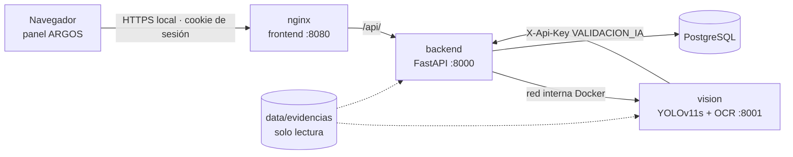
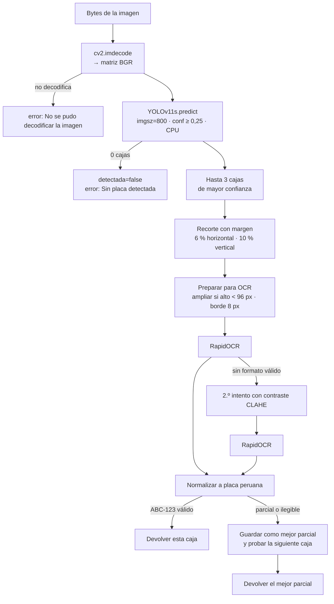
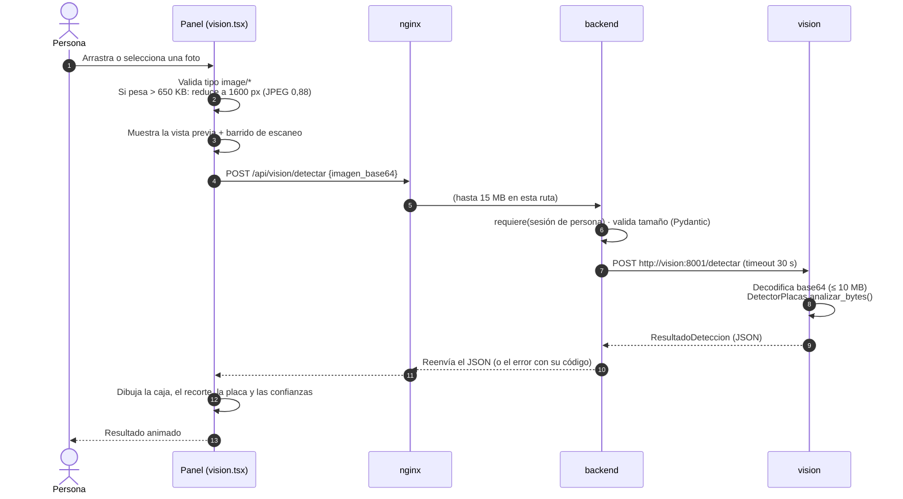
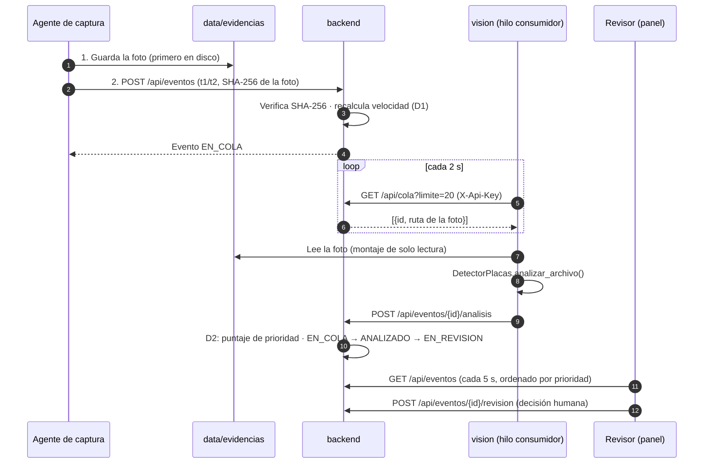

# Módulo de visión: YOLOv11s + OCR

Este documento explica cómo se integró la detección de placas en ARGOS y qué pasa con una imagen
desde que entra al sistema hasta que la persona ve el resultado.

> **Principio que no cambia:** la visión artificial **propone** una placa y una prioridad; nunca confirma ni
> descarta una infracción. La decisión final siempre la toma un revisor humano en el panel.

---

## 1. Visión general

La visión corre en un **cuarto servicio Docker** (`vision`), separado del backend:

| Servicio   | Papel en la visión |
| ---------- | ------------------ |
| `frontend` | Panel React servido por nginx. Envía la foto de prueba y dibuja el resultado. |
| `backend`  | FastAPI. Exige sesión, hace de intermediario hacia `vision`, aplica la decisión D2 y la máquina de estados. |
| `vision`   | Python 3.12 + **YOLOv11s** (ultralytics/PyTorch CPU) + **RapidOCR** (ONNX Runtime). Detecta y lee placas. |
| `db`       | PostgreSQL. Guarda cada intento de análisis (`analisis`) y la auditoría. |



Por qué un servicio aparte:

- **Peso y dependencias:** PyTorch, ultralytics y OpenCV suman varios cientos de MB. El backend sigue liviano y no depende de ellos.
- **Aislamiento:** si el modelo falla o tarda, la API, el login y la revisión humana siguen funcionando. El panel muestra "Servicio desconectado".
- **Mismo contrato que tendría un módulo externo:** `vision` usa los endpoints públicos del backend (`GET /api/cola`, `POST /api/eventos/{id}/analisis`) con una clave de servicio, igual que el agente de captura.

---

## 2. Componentes y archivos

| Archivo | Qué hace |
| ------- | -------- |
| `vision/modelos/yolov11s_placas.pt` | Pesos de YOLOv11s entrenados en Google Colab a 800×800 sobre placas peruanas. **No está en git** (`.gitignore`): cada integrante lo copia a esa carpeta. |
| `vision/detector.py` | Clase `DetectorPlacas`: YOLO → recorte → OCR → normalización al formato peruano → confianza. |
| `vision/servicio.py` | Proceso principal: servidor HTTP interno (`/salud`, `/detectar`) y consumidor de la cola en un hilo aparte. |
| `vision/Dockerfile` | PyTorch **solo CPU** (evita ~2,5 GB de CUDA) y OpenCV **headless** (ultralytics instala la versión con GUI, que necesita librerías gráficas). |
| `backend/app/routers/vision.py` | `GET /api/vision/estado` y `POST /api/vision/detectar`: exigen sesión y reenvían a `vision`. |
| `backend/app/routers/eventos.py` | `GET /api/cola` y `POST /api/eventos/{id}/analisis`: cola, decisión D2 y cambio de estado. |
| `frontend/argos-glass/src/vision.tsx` | Sección **Detección de placas**: carga de la foto, envío y visualización con animaciones. |
| `frontend/argos-glass/nginx.conf` | Permite hasta 15 MB solo en `/api/vision/detectar` (el resto conserva el límite de 1 MB). |

---

## 3. El motor de detección (`DetectorPlacas`)

Es el mismo para los dos flujos (prueba desde el panel y cola automática). Recibe los bytes de una imagen y
devuelve un `ResultadoDeteccion`.



### 3.1 Detección (YOLOv11s)

- Parámetros: `imgsz=800` (igual que en el entrenamiento), umbral de confianza `0,25`, dispositivo `cpu`.
- La inferencia se protege con un `threading.Lock`: el servidor HTTP atiende varias peticiones a la vez, pero el modelo
  procesa **una imagen por vez**. Así se evitan carreras dentro de PyTorch y picos de memoria en la laptop.
- Si hay varias cajas, se evalúan como máximo las **3 de mayor confianza**. Se devuelve la primera que dé una placa con formato
  válido; si ninguna lo da, la mejor lectura parcial.

### 3.2 Recorte y preparación para OCR

1. Se limitan las coordenadas al tamaño de la imagen y se añade un margen (6 % del ancho y 10 % del alto de la caja) para no
   cortar los bordes de los caracteres.
2. El recorte se hace **en memoria**: el archivo original nunca se modifica.
3. Si el recorte mide menos de 96 px de alto, se amplía a 112 px (interpolación cúbica); el OCR lee mal los textos muy pequeños.
4. Se añade un borde replicado de 8 px.
5. Si la primera lectura no da un formato válido, se repite con **CLAHE** (ecualización adaptativa del contraste en el canal L),
   que ayuda con placas en sombra o con reflejos.

### 3.3 Lectura (RapidOCR) y normalización

RapidOCR devuelve líneas `(caja, texto, confianza)`. Se ordenan de arriba abajo y de izquierda a derecha, y
`normalizar_placa_peru()` hace lo siguiente:

1. **Limpia** cada línea: mayúsculas y solo `A-Z0-9`.
2. **Descarta la leyenda** superior (`PERU`, `PERÚ`, `REPUBLICADELPERU`…). Si viene pegada al número (`PERUABC123`), la quita.
3. Arma **candidatos**: cada línea por separado y la unión de todas (cuando el OCR parte la placa en `A1B` + `234`).
4. Busca una **ventana de 6 caracteres** con formato SIIV: 3 alfanuméricos + 3 dígitos → `ABC-123` / `A1B-234`.
   En los 3 últimos (siempre dígitos) corrige confusiones ópticas típicas:
   `O/Q/D→0`, `I/L→1`, `Z→2`, `S→5`, `G→6`, `B→8`.
   No se corrige la primera mitad, porque ahí letras y dígitos son igualmente válidos.
5. **Respaldo:** si no hay formato válido, devuelve la mejor lectura de 4 a 8 caracteres (motos, placas antiguas o lecturas
   parciales), para que el revisor tenga una pista.

### 3.4 Confianza combinada

| Caso | Fórmula |
| ---- | ------- |
| Placa con formato válido | `0,65 · conf_YOLO + 0,35 · conf_OCR` |
| Lectura parcial | `0,50 · conf_YOLO + 0,50 · conf_OCR` |
| Placa localizada pero ilegible | `0,50 · conf_YOLO` (sin texto) |

Una placa ilegible no es un error: YOLO sí la encontró. Por eso pasa a revisión humana, con prioridad baja.

### 3.5 Respuesta

```json
{
  "detectada": true,
  "placa_candidata": "A1B-234",
  "texto_ocr": "PERU A1B-234",
  "confianza": 0.912,
  "confianza_deteccion": 0.874,
  "confianza_ocr": 0.981,
  "caja": { "x1": 1499, "y1": 719, "x2": 1577, "y2": 746, "ancho_img": 1920, "alto_img": 1080 },
  "recorte_base64": "data:image/png;base64,…",
  "tiempo_ms": 2096.4,
  "modelo_version": "yolov11s-pe+ocr",
  "error": null
}
```

`recorte_base64` solo se incluye en la prueba desde el panel; en la cola automática no hace falta.

---

## 4. Pipeline A: prueba desde el panel (de la carga al resultado)

Es el flujo de la sección **Detección de placas** del menú. No crea eventos ni guarda la imagen.



Paso a paso:

1. **Selección** (`procesarArchivo`). Se acepta arrastrar o elegir un JPG, PNG o WebP; otro tipo de archivo muestra un aviso.
2. **Preparación en el navegador** (`prepararImagenBase64`):
   - Hasta 650 KB, la imagen se envía tal cual, como *data URL* en base64.
   - Si pesa más, se redibuja en un `<canvas>` con el lado mayor en 1600 px y se exporta como JPEG de calidad 0,88. Así la
     subida es más rápida y la inferencia no cambia, porque YOLO trabaja a 800 px de todos modos.
   - La vista previa usa **esa misma imagen**, de modo que las coordenadas de la caja coinciden con lo que se ve.
3. **Mientras se espera:** la foto se atenúa, una línea de escaneo la recorre y la columna del resultado muestra un esqueleto de carga.
4. **nginx** reenvía `/api/` al backend. Solo `/api/vision/detectar` admite hasta 15 MB: 10 MB de imagen más el ~33 % que añade base64.
5. **Backend** (`POST /api/vision/detectar`):
   - Exige una **sesión de persona** (ADMINISTRADOR, REVISOR u OPERADOR); sin sesión responde 401.
   - Pydantic limita el texto base64 a 14 millones de caracteres.
   - Reenvía la petición a `http://vision:8001/detectar`, que solo es accesible dentro de la red de Docker.
   - Si `vision` no responde, devuelve 503 con un mensaje claro; si `vision` rechaza la imagen, devuelve su mismo código (413, 422…).
6. **Servicio de visión** (`/detectar`):
   - Comprueba `Content-Length` y quita el prefijo `data:image/...;base64,`.
   - Decodifica con validación estricta (422 si el base64 no es válido) y rechaza las imágenes de más de 10 MB (413).
   - Ejecuta `DetectorPlacas.analizar_bytes(..., incluir_recorte=True)`. Todo ocurre en RAM; nada se escribe en disco.
7. **Respuesta y presentación:**
   - La caja se posiciona en **porcentajes** (`x1 / ancho_img`, etc.), así que coincide con la foto a cualquier tamaño de pantalla.
   - Animaciones: un marco se cierra sobre la placa, la placa se revela carácter a carácter, los porcentajes cuentan desde 0 y las
     barras se llenan (verde ≥ 75 %, ámbar ≥ 45 %, rojo por debajo).
   - Si no hubo detección, se muestra el motivo (`Sin placa detectada por YOLOv11s`).

**Tiempo típico en CPU:** de 1,7 a 3,5 s por foto de 1920×1080. La primera inferencia después de arrancar es más lenta.

Además, el panel consulta `GET /api/vision/estado` cada 6 s, sin renovar la inactividad de la sesión (cabecera
`X-Argos-Sondeo`). Esa consulta llena la franja superior: modelo cargado, resolución y motor, eventos en cola y eventos
analizados desde el arranque.

---

## 5. Pipeline B: cola automática (eventos reales)

Es el flujo de producción: cada infracción medida por las barreras pasa por el modelo sin intervención de nadie.



1. El **agente** guarda la foto en `data/evidencias/` y registra el evento. El backend verifica el SHA-256, recalcula la velocidad
   y deja el evento en **`EN_COLA`**.
2. El **hilo consumidor** de `vision` consulta `GET /api/cola?limite=20` cada 2 s (`INTERVALO_COLA_S`), autenticándose con
   `X-Api-Key: ARGOS_CLAVE_VISION` (rol `VALIDACION_IA`). Sin clave, el servicio HTTP sigue activo y deja un aviso en el log.
3. Para cada evento abre la foto **en solo lectura**: la carpeta está montada con `:ro`, y `_ruta_evidencia_segura` impide salir de
   ella. Nunca se modifica la evidencia, así que su SHA-256 sigue siendo válido.
4. Envía el resultado a `POST /api/eventos/{id}/analisis`:

   | Resultado del modelo | Qué envía | Qué hace el backend |
   | -------------------- | --------- | ------------------- |
   | Placa leída (o parcial) | `placa_candidata`, `confianza`, `modelo_version` | Calcula **D2** y pasa el evento a `ANALIZADO` → `EN_REVISION` |
   | Placa localizada pero ilegible | `placa_candidata: null`, confianza baja | `EN_REVISION` con prioridad baja (el revisor escribe la placa) |
   | Sin placa / archivo faltante / fallo interno | `error` | Registra el intento fallido; al **3.º** (`MAX_INTENTOS_ANALISIS`) pasa a **`INCIERTO`** con el motivo |

5. **Decisión D2** (backend). Solo ordena la cola de revisión, nunca decide:

   ```
   margen  = clamp((velocidad − límite) / límite, 0, 1)
   puntaje = 0,6 · confianza + 0,4 · margen
   si la placa no cumple ^[A-Z0-9]{3}-?\d{3}$ → puntaje × 0,5
   ```

6. Cada intento queda en la tabla `analisis` (placa, confianza, puntaje, `modelo_version`, error), y cada cambio de estado en la
   `auditoria`, que no se puede modificar.
7. El **panel** consulta los eventos cada 5 s, ordenados por prioridad. La tabla muestra la versión del modelo que analizó cada
   evento, y un **revisor** confirma, corrige o descarta la placa.

---

## 6. Configuración

Variables del servicio `vision` (en `docker-compose.yml`; si no están definidas, también se leen de `.env`):

| Variable | Valor por defecto | Uso |
| -------- | ----------------- | --- |
| `MODELO_RUTA` | `/srv/modelos/yolov11s_placas.pt` | Pesos de YOLOv11s |
| `MODELO_IMGSZ` | `800` | Resolución de inferencia (igual que en el entrenamiento) |
| `MODELO_UMBRAL` | `0.25` | Confianza mínima de una caja |
| `MODELO_DISPOSITIVO` | `cpu` | `cpu` o `cuda:0` si hubiera GPU |
| `MODELO_VERSION` | `yolov11s-pe+ocr` | Etiqueta guardada en `analisis.modelo_version` |
| `INTERVALO_COLA_S` | `2.0` | Pausa entre consultas a la cola |
| `API_URL` | `http://backend:8000` | Backend |
| `EVIDENCIAS_DIR` | `/data/evidencias` | Fotos (solo lectura) |
| `ARGOS_CLAVE_VISION` | — | Clave de servicio con rol `VALIDACION_IA` |

En el backend, `VISION_URL=http://vision:8001` indica dónde está el servicio.

Puesta en marcha:

```bash
cp ruta/al/yolov11s_placas.pt vision/modelos/
docker compose exec backend python -m app.claves crear vision VALIDACION_IA   # copia la línea ARGOS_CLAVE_VISION=… a .env
docker compose up -d --build vision
docker compose logs -f vision     # "Modelo yolov11s-pe+ocr listo." y luego un log por evento analizado
```

Pruebas sin panel:

```bash
# Una imagen suelta, dentro del contenedor (imprime el JSON del resultado)
docker compose exec vision python servicio.py --imagen /ruta/dentro/del/contenedor.jpg

# Encolar fotos reales como eventos para que el servicio las procese (no usar --analizar)
python agente/simulador.py --foto ruta/a/fotos/
```

---

## 7. Seguridad y privacidad

- **Sin puerto publicado:** `vision` solo es accesible dentro de la red de Docker. `/detectar` no tiene autenticación propia; la
  protección la pone el backend, que exige sesión.
- **La prueba no deja rastro:** la imagen vive solo en memoria (navegador → backend → vision) y no se guarda ni se registra como
  evento (Ley N.° 29733).
- **Evidencias intactas:** montaje de solo lectura, rutas confinadas y verificación SHA-256 en el backend.
- **Identidad del servicio:** la cola usa una clave de API con rol `VALIDACION_IA`, que no puede revisar eventos ni ver usuarios.
  Todo análisis queda auditado como `servicio:vision`.
- **Límites de tamaño** en tres capas: navegador (reduce a 1600 px), nginx (15 MB) y servicio (10 MB de imagen decodificada).

---

## 8. Limitaciones conocidas

- **Resolución de la cámara:** si la placa ocupa menos de unos 80×25 px o está movida, YOLO la localiza pero el OCR no puede leerla.
  Es el caso del video ilustrativo de la página de inicio. Hacen falta fotos de la cámara real, con buena exposición y obturación
  rápida, para medir la lectura.
- **CPU:** de 2 a 3 s por imagen. Alcanza para un punto de control con tráfico moderado; con más tráfico conviene una GPU
  (`MODELO_DISPOSITIVO=cuda:0`) o exportar el modelo a ONNX.
- **Reintentos:** cuando no hay placa, el resultado es determinista, así que los 3 intentos dan lo mismo antes de pasar a `INCIERTO`.
  Cuesta unos segundos de CPU por evento.
- **Una inferencia a la vez:** por el candado, una prueba desde el panel espera si en ese momento se está analizando la cola.
- **Licencia:** ultralytics se distribuye bajo AGPL-3.0. Para el prototipo académico no hay problema, pero debe considerarse si el
  sistema se distribuye.
- **Modelo fuera de git:** `yolov11s_placas.pt` (~19 MB) se comparte aparte.
